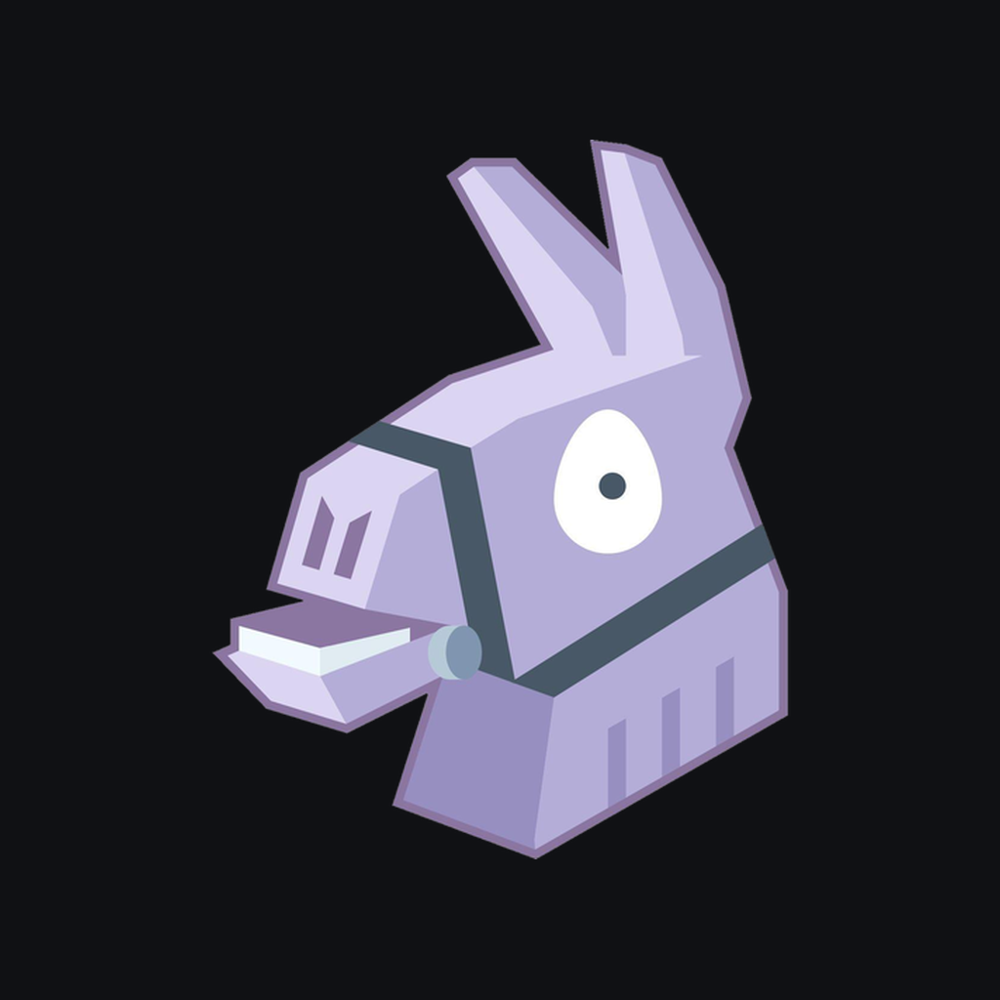

<h2 align="center">Radarnite</h2>

<b>Fortnite Item Shop radar.</b> Today's shop, return predictions from real shop history, seamless emote loops and your locker, in one place.

<a href="https://fn.justdiego.com"><b>fn.justdiego.com</b></a>

---

- **Item Shop** with every section, what changed since yesterday and what leaves tonight.
- **Return predictions** trained on years of shop history, with an estimated date and a likely window.
- **Seamless emote loops**: picture and music verified to join without a cut.
- **Wishlist and locker** synced from your Epic account, with alerts when something you want is back.
- **18 languages**, light and dark themes.

Unofficial fan project. Not affiliated with or endorsed by Epic Games. Fortnite is a trademark of Epic Games, Inc.
